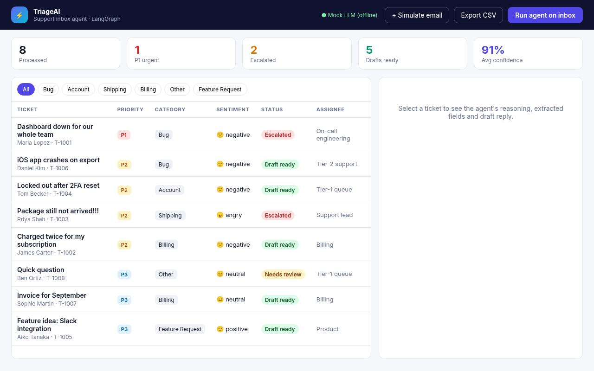
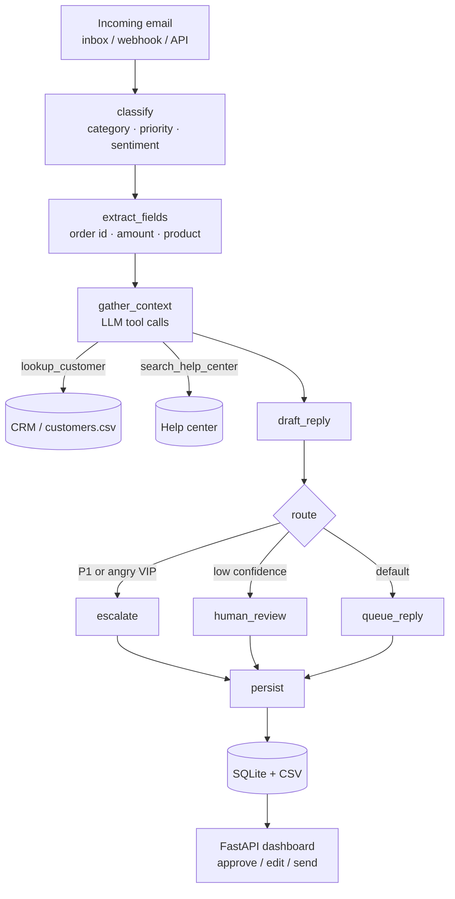
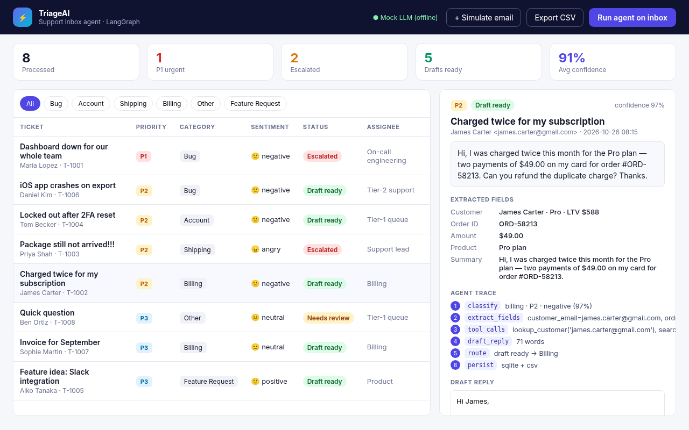
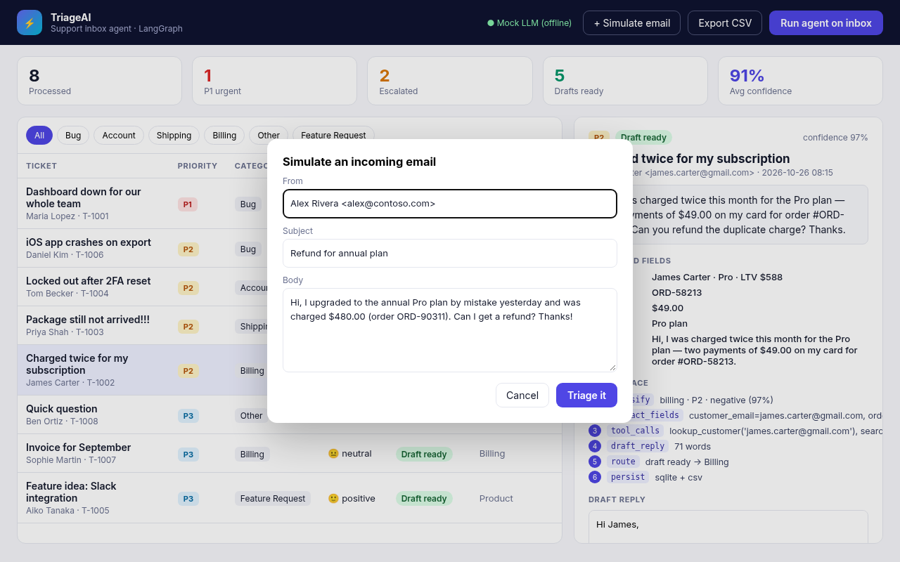
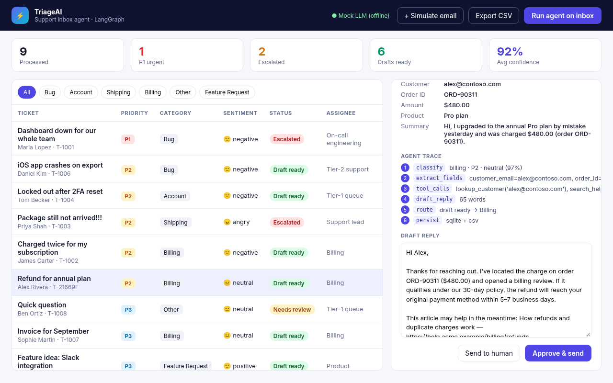

# TriageAI — AI Support Inbox Agent (LangGraph)

**An AI agent that reads incoming support emails and triages them: it classifies, prioritizes, extracts fields, looks up the customer, drafts a reply, routes the ticket and logs everything to a database and CSV. A human approves before anything is sent.**

Built with **Python · LangGraph · OpenAI tool calling & structured outputs · FastAPI · SQLite**.
Runs fully offline in **mock mode** (no API key, deterministic) so you can try it right away.



## The problem

Support teams spend the first hours of every day sorting the inbox: working out what each email is about, how urgent it is, who the customer is, and who should handle it. Urgent outages get buried under invoice requests, and angry VIP customers wait in the same queue as everyone else.

## What it does

- **Classify:** category (billing, bug, account, shipping, feature request, other), priority (P1–P3), sentiment and a confidence score.
- **Extract** structured fields: customer email, order ID, amount, product and a one-line summary.
- **Call tools** to gather context: `lookup_customer` (CRM: plan, lifetime value) and `search_help_center` (relevant articles).
- **Draft a reply** that is empathetic, policy-aware and links the right help article.
- **Route** with a conditional graph edge:
  - P1, or an angry Enterprise/high-LTV customer → **Escalated** (on-call engineering or support lead)
  - Low confidence or unclear → **Needs human review**
  - Everything else → **Draft ready** for the right team
- **Persist** every ticket to **SQLite** and mirror it to **CSV** (ready for Google Sheets, Zapier or BI).
- **Dashboard:** KPIs, filters, per-ticket **agent trace** (each graph node and what it did), editable draft and *Approve & send*.
- **Human-in-the-loop by design:** nothing is sent automatically.

## Architecture



The graph is a real `langgraph.StateGraph` (`triage_agent/agent.py`). The LLM sits behind one small interface (`triage_agent/llm.py`) with two implementations:

| Backend | How |
|---|---|
| `OpenAILLM` | `gpt-4o-mini`, Pydantic **structured outputs** for classification and extraction, **function/tool calling** for context gathering |
| `MockLLM` | Deterministic keyword and regex rules. Offline, free and reproducible (used in tests and demos) |

## Run it locally

```bash
python -m venv .venv && source .venv/bin/activate
pip install -r requirements.txt

# CLI: triage the sample inbox and print a table
python -m triage_agent

# Dashboard: http://localhost:8000
uvicorn triage_agent.server:app --reload

# Tests
pytest -q
```

Set `OPENAI_API_KEY` (see `.env.example`) to switch from the mock LLM to OpenAI. The badge in the top bar shows the active mode.

### API

| Method | Path | Description |
|---|---|---|
| `POST` | `/api/process-inbox` | Triage every unprocessed email in `data/inbox.json` |
| `POST` | `/api/emails` | Triage a single new email `{sender, subject, body}` (webhook-friendly) |
| `GET` | `/api/tickets` / `/api/tickets/{id}` | Triaged tickets with fields, tool context and trace |
| `PATCH` | `/api/tickets/{id}` | Approve/send or send to a human; edit the reply |
| `GET` | `/api/export.csv` | CSV export |

## Sample output (mock mode)

```
ID       PRI  CATEGORY         SENTIMENT STATUS        ASSIGNEE
T-1001   P1   bug              negative  escalated     On-call engineering
T-1002   P2   billing          negative  draft_ready   Billing
T-1003   P2   shipping         angry     escalated     Support lead
T-1004   P2   account          negative  draft_ready   Tier-1 queue
T-1005   P3   feature_request  positive  draft_ready   Product
T-1006   P2   bug              negative  draft_ready   Tier-2 support
T-1007   P3   billing          neutral   draft_ready   Billing
T-1008   P3   other            neutral   needs_review  Tier-1 queue
```

## Screenshots

| Triaged inbox | Ticket detail & agent trace |
|---|---|
|  |  |
| **Simulate an incoming email** | **Draft reply, ready for approval** |
|  |  |

## Adapting it to your stack

Swap `data/inbox.json` for a Gmail/Outlook/IMAP poller or a Zendesk, Freshdesk, Intercom or HubSpot webhook. Replace `lookup_customer` with your CRM and SQLite with Postgres/Supabase. Send approved replies through your helpdesk API.

## License

MIT
